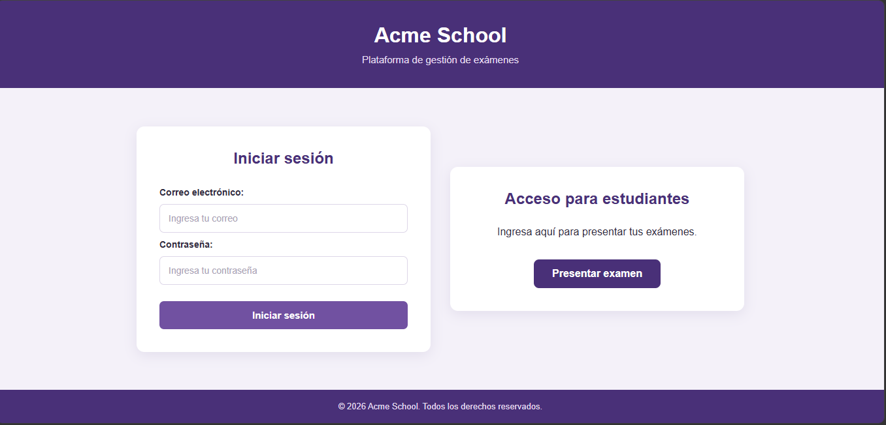
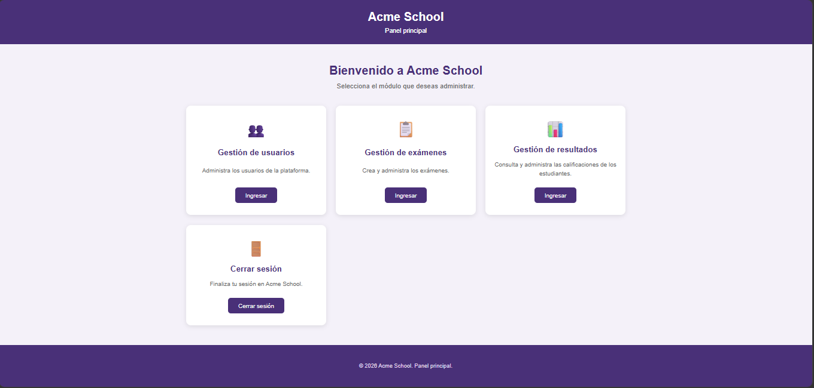
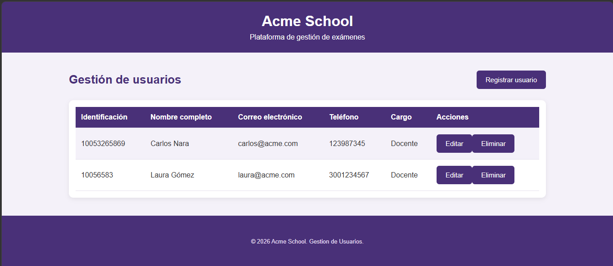
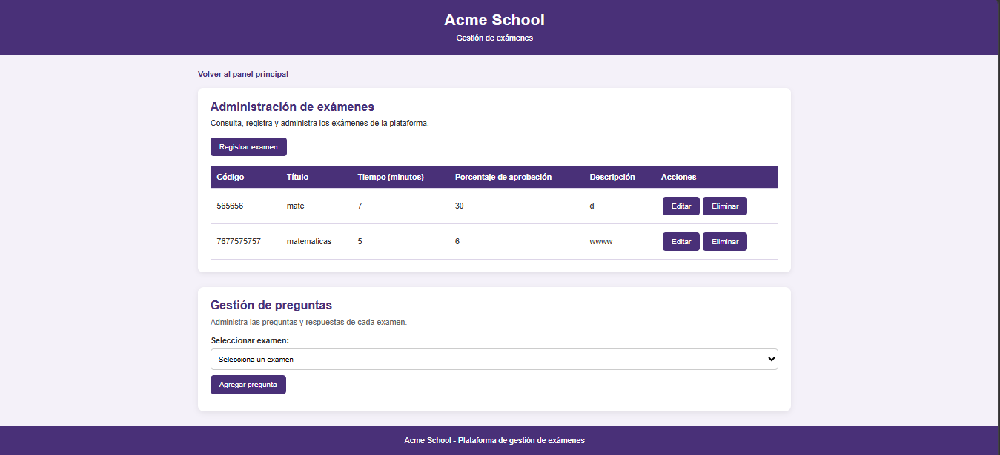
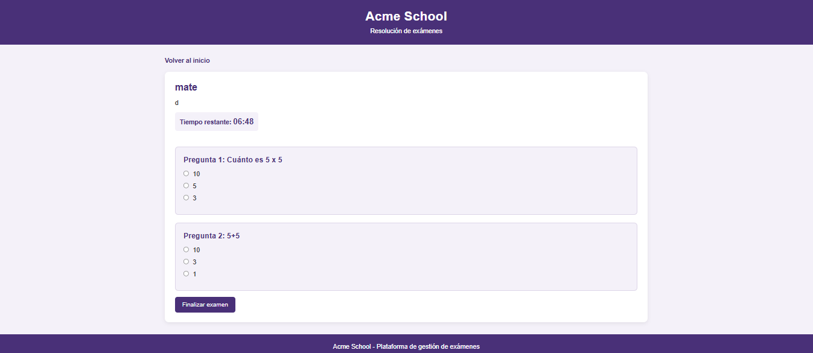
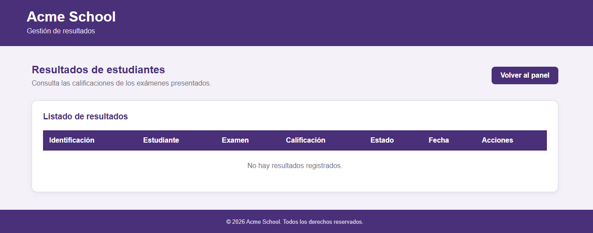

# Acme School – Plataforma para exámenes

**Autor:** Juan Sebastian Sierra
**Repositorio:** https://github.com/juansebastiansierravelasco/ProyectoAcmeschool_SierraJuanSebastian.git

## 1. Descripción del proyecto

Acme School es una plataforma web desarrollada con HTML, CSS y JavaScript que permite administrar usuarios, crear exámenes y facilitar su presentación por parte de los estudiantes.

El sistema cuenta con un módulo privado para la administración y un módulo público para que los estudiantes puedan resolver los exámenes sin necesidad de iniciar sesión.

## 2. Objetivos

- Facilitar la creación y administración de exámenes.
- Gestionar los usuarios que tienen acceso a los módulos administrativos.
- Permitir que los estudiantes presenten exámenes en línea.
- Calcular automáticamente las calificaciones.
- Almacenar la información para consultarla posteriormente.

## 3. Funcionalidades

### Inicio de sesión

- Autenticación mediante correo electrónico y contraseña.
- Protección de los módulos administrativos.

### Gestión de usuarios

- Registrar usuarios.
- Consultar usuarios en una tabla.
- Editar información.
- Eliminar registros.

Los datos gestionados son identificación, nombre completo, correo electrónico, teléfono, cargo y contraseña.

### Gestión de exámenes

- Crear, consultar, editar y eliminar exámenes.
- Registrar código, título, descripción, tiempo y porcentaje de aprobación.
- Crear y administrar preguntas.
- Agregar opciones de respuesta y establecer la respuesta correcta.

### Resolución de exámenes

- Consultar los exámenes disponibles.
- Registrar la identificación y el nombre del estudiante.
- Seleccionar las respuestas de cada pregunta.
- Visualizar un temporizador con el tiempo restante.
- Finalizar el examen y obtener la calificación automáticamente.

### Gestión de resultados

- Consultar las calificaciones de los estudiantes.
- Visualizar identificación, nombre, examen, calificación, estado y fecha.
- Eliminar resultados registrados.

## 4. Tecnologías utilizadas

- **HTML5:** estructura de las páginas.
- **CSS3:** estilos, diseño visual y adaptación responsive.
- **JavaScript:** lógica, validaciones e interactividad.
- **LocalStorage:** almacenamiento de la información en el navegador.
- **Git y GitHub:** control de versiones y alojamiento del repositorio.

## 5. Estructura del proyecto

```text
Acme-School/
│
├── index.html
│
├── css/
│   ├── styles.css
│   ├── dashboard.css
│   ├── usuarios.css
│   ├── examenes.css
│   ├── resolver.css
│   └── resultados.css
│
├── js/
│   ├── main.js
│   ├── auth.js
│   ├── storage.js
│   ├── usuarios.js
│   ├── examenes.js
│   ├── resolver.js
│   ├── dashboard.js
│   └── resultados.js
│
├── pages/
│   ├── dashboard.html
│   ├── usuarios.html
│   ├── examenes.html
│   ├── resolver.html
│   └── resultados.html
│
├── mockups/
│
└── README.md
```

## 6. Almacenamiento de datos

La aplicación utiliza `localStorage` para guardar y recuperar la información del sistema.

Los datos se almacenan en formato JSON, permitiendo conservar los registros incluso después de cerrar o actualizar el navegador.

La persistencia se implementa para:

- Usuarios.
- Exámenes y preguntas.
- Resultados de los estudiantes.
- Sesión del usuario administrador.

**Nota:** la información se conserva en el navegador donde se utiliza la aplicación; no se utiliza una base de datos en un servidor.

## 7. Diseño responsive

La interfaz está diseñada para adaptarse a diferentes tamaños de pantalla, buscando mantener una experiencia clara y sencilla.

Se contemplan tres tipos de dispositivos:

- **Computadores:** distribución amplia y aprovechamiento del espacio.
- **Tabletas:** reorganización de los elementos para facilitar la navegación.
- **Celulares:** contenido organizado en una sola columna, botones adaptados y tablas con desplazamiento horizontal cuando es necesario.

Se utilizan media queries de CSS para ajustar la presentación según el ancho de pantalla, principalmente alrededor de los 900 px y 600 px.

## 8. Mockups del proyecto

En esta sección se presentan los diseños de las diferentes vistas de Acme School, tanto en versión de computador como de celular.

### Inicio de sesión





### Panel principal





### Gestión de usuarios





### Gestión de exámenes





### Resolución de exámenes





### Gestión de resultados





## 9. Instalación y ejecución

1. Descargar o clonar el repositorio desde GitHub.
2. Abrir la carpeta del proyecto en Visual Studio Code.
3. Instalar la extensión Live Server, si no está instalada.
4. Abrir el archivo `index.html`.
5. Seleccionar la opción **Open with Live Server**.
6. La aplicación se abrirá en el navegador.

## 10. Autor

Juan Sebastian Sierra 

Proyecto desarrollado como parte del proceso de formación en Desarrollo de Software, aplicando conocimientos de HTML, CSS y JavaScript.
